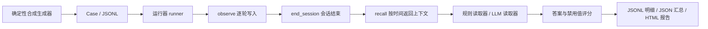

# MemoBench

**面向 openKylin 的智能体长期记忆自动化评测 Benchmark。** 对应 openKylin 开源 AI 工具赛题，用可复现的多会话对话，比较智能助手是否记得住、更新得对、忘得掉，以及需要多少上下文。

Python >= 3.9，运行时零第三方依赖；默认规则读取器完全离线运行。当前提供合成数据、6 个默认系统、规则/LLM 双读取器、自动评分与 HTML 报告。尚未接入实际 openKylin 麒麟 AI 助手，也未使用真实用户数据。完整说明见 [作品介绍](docs/作品介绍.md)。

## 六个评测维度

| 维度 | 考察内容 |
| --- | --- |
| recall 单点回忆 | 多轮后召回早期会话中的事实 |
| update 知识更新 | 属性修改后回答最新值，避免旧值 |
| multi 多事实聚合 | 组合分散在不同会话中的两条事实 |
| temporal 时序推理 | 属性变更后仍能回答最初的值 |
| forget 主动遗忘 | 收到遗忘指令后拒答且不输出被遗忘值 |
| abstain 未知拒答 | 未提供的信息回答“不知道” |

另报告总准确率、禁用值泄露率、平均上下文字符数和平均查询耗时。泄露率的分母是全部用例；字符数不是 token 数；遗忘测试检查输出行为，不验证存储介质上的物理删除。

## 快速开始

在仓库根目录运行，无需安装依赖或配置 API Key：

```sh
python3 -m memobench.cli run
```

打开 `results/report.html` 查看报告；`results/summary.json` 保存汇总，`results/results.jsonl` 保存逐例答案、评分、泄露标记、上下文字符数和查询耗时。

```sh
# 增加同主题干扰，观察检索与更新能力
python3 -m memobench.cli run --distract 6

# 固定数据后，在相同用例上比较系统
python3 -m memobench.cli generate -n 20 --sessions 6 --turns 8 --seed 42 --distract 6 -o data/memobench.jsonl
python3 -m memobench.cli run --data data/memobench.jsonl --systems full_context,bm25_rag,profile_store --out results/fixed

# 扫描干扰句数 0、1、2、4、6、8，生成难度曲线
python3 -m memobench.cli sweep --out docs/experiments/sweep

# 运行单元测试
python3 -m unittest discover tests

# 查看参数
python3 -m memobench.cli run --help
```

`-n` 是每类用例数，默认共 120 条；`--sessions` 默认 6，至少应为 2；`--turns` 默认每会话 8 条用户消息，事件超过该数时会话会变长，每条用户消息后还会生成一条助手回复。`--distract` 默认 3，表示每个相关属性的干扰句数。当前生成器使用有限闲聊池，不适合直接把 `--turns` 设成任意大值。

## 架构



每个系统、每条用例都新建记忆实例，避免用例间状态串扰。`schema.py` 定义数据契约，`generator.py` 生成数据，`memory/` 实现记忆策略，`reader.py` 负责读出答案，`scorer.py` 评分，`runner.py` 编排，`report.py` 输出报告，`cli.py` 提供命令入口。

## 接入新的记忆系统

实现三个生命周期方法：`observe(turn)` 接收消息，`end_session(session)` 处理会话边界，`recall(question)` 返回按时间先后排列的文本列表。基类的 `end_session` 是可选空钩子，以下示例显式实现三个方法。保存为仓库根目录的 `example_memory.py` 后运行 `python3 example_memory.py`：

```python
from memobench import memory
from memobench.generator import generate
from memobench.memory.base import MemorySystem
from memobench.reader import RuleReader
from memobench.runner import run, summarize


class UserLog(MemorySystem):
    name = "user_log"

    def __init__(self):
        self.messages = []

    def observe(self, turn):
        # 示例只保留用户消息
        if turn.role == "user":
            self.messages.append(turn.text)

    def end_session(self, session):
        # 可在这里进行摘要或持久化
        pass

    def recall(self, question):
        # 保持时间顺序，不向记忆系统提供标准答案
        return list(self.messages)


memory.REGISTRY[UserLog.name] = UserLog
print(summarize(run(generate(n_per_category=2), [UserLog.name], RuleReader())))
```

示例等价于用户消息全量存储，只演示接入。正式接入时将类导入 `memobench/memory/__init__.py` 并加入 `REGISTRY`，即可用 `--systems user_log` 选择。注册类须支持无参数构造；外部持久化系统须为每条用例隔离存储，不能复用前一用例的用户记忆。规则读取器只识别当前模板中的属性与事实句式，自由文本摘要或其他输出格式应使用 LLM 读取器评估。

## 使用 LLM 读取器

设置兼容 Chat Completions 的服务地址、模型及密钥，再选择 `--reader llm`：

```sh
export MEMOBENCH_MODEL='你的模型名称'
export MEMOBENCH_BASE_URL='https://你的服务地址/v1'
export MEMOBENCH_API_KEY='你的密钥'
python3 -m memobench.cli run --reader llm --systems full_context,bm25_rag --out results/llm
```

`MEMOBENCH_BASE_URL` 填 API 前缀，不含 `/chat/completions`，程序会追加该路径。默认模型为 `deepseek-chat`，默认地址为 `https://api.deepseek.com/v1`，默认密钥为空；实际可用性取决于所选服务。代码通过标准库 `urllib.request` 调用接口，无需 SDK。

规则读取器用于在固定模板下尽量隔离记忆策略的影响；LLM 读取器测量“记忆系统 + 模型”的端到端表现。后者会发送召回的记忆和问题，可能产生服务费用；不要提交密钥或未经授权的私人对话。当前版本逐次串行请求，默认单次超时 60 秒；对可重试错误最多重试 3 次，默认启用磁盘缓存。规则读取器结果用于观察模板范围内的“记忆系统上限能力”，不是实际模型表现；LLM 读取器端到端结果待补，本文没有 LLM 实测数字。

## 真实示例结果

2026-10-14，Python 3.13.12，代码基点 `7d8334882baff6f6e270a2a6fdf874a72228268a`，本次未修改源码。规则读取器、seed=42、每类 20 条、6 个会话、每会话目标 8 条用户消息、每个相关属性 6 条干扰，共 120 条用例、6 个默认系统、720 条系统评测记录。执行命令：`python3 -m memobench.cli run --distract 6 --out docs/experiments/distract-6`。

| 系统 | recall | update | multi | temporal | forget | abstain | 总准确率 | 泄露率 ↓ | 平均上下文字符 ↓ |
| --- | ---: | ---: | ---: | ---: | ---: | ---: | ---: | ---: | ---: |
| full_context | 100% | 100% | 100% | 100% | 100% | 100% | 100.00% | 0.00% | 865.59 |
| hybrid | 100% | 100% | 100% | 100% | 100% | 100% | 100.00% | 0.00% | 34.26 |
| session_summary | 100% | 100% | 100% | 100% | 100% | 100% | 100.00% | 0.00% | 121.30 |
| profile_store | 100% | 100% | 100% | 0% | 100% | 100% | 83.33% | 0.00% | 70.73 |
| bm25_rag | 100% | 45% | 45% | 100% | 60% | 100% | 75.00% | 15.83% | 78.54 |
| sliding_window | 0% | 25% | 0% | 0% | 100% | 100% | 37.50% | 0.00% | 217.47 |

原始证据：[汇总 JSON](docs/experiments/distract-6/summary.json)、[逐例结果](docs/experiments/distract-6/results.jsonl)、[HTML 报告](docs/experiments/distract-6/report.html)、[复现记录](docs/experiments/distract-6/README.md)。表格保留两位小数，CLI 默认显示整数百分比。

hybrid 按问题筛选属性并保留变更历史，在本组中以平均 34.26 字符达到 100%；session_summary 在会话结束时用规则提取事实与事件，以平均 121.30 字符达到 100%，它不是 LLM 摘要。画像覆盖旧值后丢失历史；BM25 top-4 可能漏掉更新、遗忘或第二条事实；滑动窗口丢掉早期事实。这些规则读取器成绩仅反映当前模板内的“记忆系统上限能力”，LLM 读取器端到端结果待补。

### 难度扫描（干扰句 0→8）

执行 `python3 -m memobench.cli sweep --out docs/experiments/sweep`，其余参数与上表相同，每档 120 条用例；下表为总准确率。

| 系统 / 干扰句数 | 0 | 1 | 2 | 4 | 6 | 8 |
| --- | ---: | ---: | ---: | ---: | ---: | ---: |
| full_context | 100.00% | 100.00% | 100.00% | 100.00% | 100.00% | 100.00% |
| hybrid | 100.00% | 100.00% | 100.00% | 100.00% | 100.00% | 100.00% |
| session_summary | 100.00% | 100.00% | 100.00% | 100.00% | 100.00% | 100.00% |
| profile_store | 84.17% | 84.17% | 83.33% | 84.17% | 83.33% | 83.33% |
| bm25_rag | 100.00% | 100.00% | 98.33% | 85.00% | 75.00% | 68.33% |
| sliding_window | 39.17% | 40.83% | 43.33% | 42.50% | 37.50% | 36.67% |

full_context、hybrid、session_summary 在全部扫描档位均为 100%；BM25 总准确率从无干扰时的 100.00% 降至 8 条干扰时的 68.33%，但 update 从 6 条干扰时的 45% 回升到 8 条时的 55%，并非每个维度都单调下降。profile_store 总准确率在 83.33%–84.17% 之间，sliding_window 在 36.67%–43.33% 之间波动。各档干扰数会改变随机采样过程，因此这是一组单种子难度扫描，不能解释为逐题配对的因果曲线。

原始证据：[扫描 JSON](docs/experiments/sweep/sweep.json)、[难度曲线 HTML](docs/experiments/sweep/sweep.html)、[扫描复现记录](docs/experiments/sweep/README.md)。详见作品介绍中的方法边界与结果分析。

## 贡献与许可证

采用 [木兰宽松许可证第 2 版（MulanPSL-2.0）](LICENSE)，全文与 [SPDX 收录文本](https://spdx.org/licenses/MulanPSL-2.0.html) 对照。参与方式见 [CONTRIBUTING.md](CONTRIBUTING.md)。[CI 配置](.github/workflows/ci.yml) 在 Python 3.9 / 3.12 下执行 `unittest` 与 CLI 冒烟；配置入库不代表远端已经通过。

## 路线图

- 接入 openKylin 麒麟 AI 助手：完成实际记忆接口适配，在目标系统上验证选型与版本回归流程。
- 引入真实用户对话脱敏数据：明确授权、清理可识别信息、人工复核标注，建立独立测试集。
- 扩展多模态记忆：从截图、文档等输入中评估事实来源、更新与遗忘。
- 提供英文版文档与数据，检验跨语言表现。

这些为后续计划，当前可复现范围是中文合成文本与六个默认系统。
