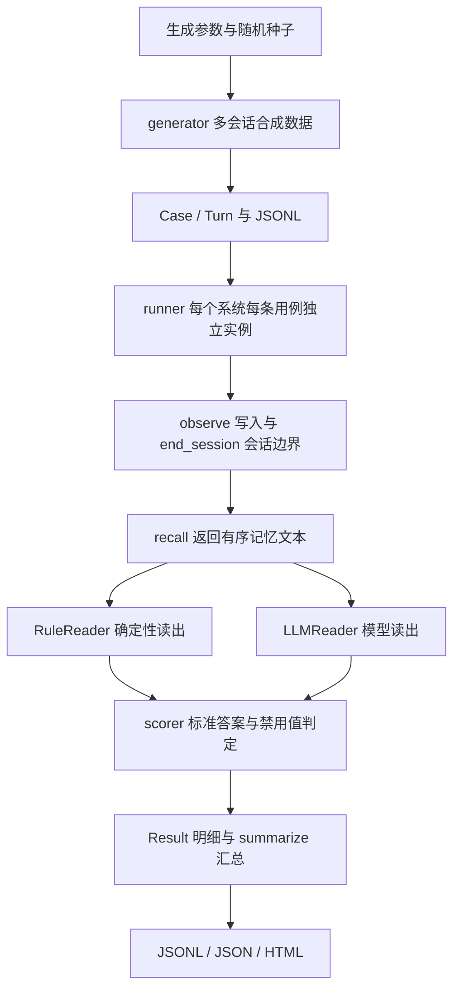

# MemoBench：面向 openKylin 的智能体长期记忆自动化评测

MemoBench 面向 openKylin 开源 AI 工具赛题，为智能助手的长期记忆方案提供可重复运行、可定位失败、可比较上下文成本的评测工具。当前版本以中文桌面使用场景为基础，完成合成数据生成、四种记忆基线、双读取器、六维评分和报告的闭环。Python >= 3.9，运行时零第三方依赖，默认评测无需联网。

当前成果是可运行的评测框架与合成数据实验，尚未完成麒麟 AI 助手实机接入、真实用户验证或 LLM 端到端实测。

## 一、项目背景与痛点

桌面助手需要持续理解用户偏好，例如常用编辑器、CPU 架构和工作目录。但长期记忆不仅要保存事实，还需要区分“我的配置”和“同事的配置”、处理用户更正、回答历史状态，并执行遗忘要求。单轮问答准确率难以揭示这些差异。

开发者也面对具体取舍：全量历史上下文长，有限窗口会遗漏早期事实，相关性检索可能漏掉更新或删除指令，画像覆盖更新后无法回溯历史。若每次用不同对话手工比较，结果难以复现，也不容易发现版本回归。

MemoBench 将这些问题转换为同一数据契约下的独立用例，输出各维度分数、逐例答案与上下文字符数，服务记忆方案的选型、调试和回归。这里的痛点是工程问题定义，尚无用户访谈或生产部署效果数据支撑规模性判断。

## 二、技术架构



`MemorySystem` 将写入、会话处理和召回分开，适配器只接收对话轮次与问题，不接触答案。`observe` 与 `recall` 是抽象方法；`end_session` 提供默认空实现，可用于会话摘要或持久化。运行器按会话和轮次顺序输入数据，再统一读出、评分，减少不同系统比较时的流程差异。

内置 `full_context` 返回全部用户消息；`sliding_window` 返回最后 12 条用户消息；`bm25_rag` 使用字符二元组 BM25，默认 top-4，召回后恢复原时间顺序；`profile_store` 通过正则抽取键值画像，覆盖更新并响应删除。BM25 是关键词检索基线，并非向量模型实测。窗口基线内部仍保存完整轮次，只限制召回，因此本文不把上下文缩短解释为存储占用降低。

## 三、评测方法学

### 1. 数据生成与干扰注入

生成器使用局部 `random.Random(seed)`，围绕桌面环境、编辑器、终端、开发语言等 12 类属性，构造六类用例及其标准答案。每条用例是一组独立的多会话对话，问题在全部会话结束后提出；当前每条用例只有一个最终问题。

默认每类 20 条、6 个会话、每会话目标 8 条用户消息，每条用户消息附一条固定助手回复。事实与更正、遗忘事件按指定会话安排，再与闲聊交错，保持事件相对顺序。事件数量超过目标轮数时不会被截断；有限闲聊池也限制了任意放大轮数的用法。

干扰句包含同事或室友的偏好、旧系统配置、尚未确定的选择和比较请求。`--distract` 控制每个相关属性的干扰数，多事实用例涉及两个属性。干扰可以与问题高度相关，却不是当前用户的有效事实，因而能暴露单纯按关键词相似度召回的不足。改变干扰数会改变随机数消耗及后续生成内容，所以不同干扰数的分数不能直接视为严格配对的因果实验；正式难度研究需固定事实骨架并使用多个种子。

当前更新用例实际包含一次更正；时序用例问最初值，尚未覆盖任意时间点查询或复杂更新链。真实对话与多模态输入列入后续规划。

### 2. 六维能力

| 标识 | 构造与预期行为 |
| --- | --- |
| recall | 首会话陈述事实，最终仍回答该值 |
| update | 后续会话更正属性，回答新值，旧值列入禁用值 |
| multi | 两个属性分布在不同会话，答案同时包含两值 |
| temporal | 属性发生变更，问题要求返回最初值 |
| forget | 用户要求遗忘后回答不知道，原值列入禁用值 |
| abstain | 对目标属性只有干扰、没有有效陈述，应拒答 |

### 3. 规则读取器与 LLM 读取器

规则读取器按当前属性词表和句式扫描有序上下文，识别陈述、更正、遗忘及“最初”问题，避免模型随机性干扰基线对比。它在模板约束内尽量隔离记忆选择和保留策略的影响，但结果仍依赖读取规则与记忆文本格式，不能视为与读取器完全无关的记忆能力。

LLM 读取器将同一问题和召回文本送入兼容 Chat Completions 的服务，以 `temperature=0` 读取答案，测量记忆系统与模型组合的端到端表现。通过 `MEMOBENCH_MODEL`、`MEMOBENCH_BASE_URL`、`MEMOBENCH_API_KEY` 配置；具体命令见 [README](../README.md)。当前使用标准库 HTTP 客户端、串行请求、60 秒超时，尚无重试或缓存。即使温度为零，服务端结果也不保证完全确定。

正式端到端比较需要固定数据、模型版本、提示词及参数，记录服务与日期，并保留原始回答。本文实验仅使用规则读取器。

### 4. 指标定义与边界

设某系统有 N 条评测结果，正确标记为 correct，泄露标记为 leaked：

- **分类准确率**：该类别正确用例数 / 该类别用例总数。
- **总准确率 overall**：全部正确用例数 / N。默认各类等量时等于六类准确率的平均；自定义不均衡数据时不等于宏平均。
- **泄露率 leak_rate**：出现至少一个禁用值的用例数 / N。分母不是仅含禁用值的用例数；目前禁用值主要来自更新和遗忘用例。
- **平均上下文字符 avg_ctx**：各次 `recall` 返回文本列表的字符长度之和再取平均，不含拼接分隔符和 LLM 提示词，不是 token、存储量或账单成本。
- **平均查询耗时 avg_ms**：`recall` 和读取器作答的合计耗时均值，不包含写入、会话处理和评分。LLM 模式含网络调用耗时。

评分器对普通答案转小写并删除空格，检查是否包含全部标准值且不含禁用值；拒答要求包含“不知道”等已列出的拒答短语且无禁用值。这是子串规则，不是语义裁判：长短值相互包含时可能误判，额外无关内容也未必被惩罚。遗忘得分只证明在当前问题中未输出禁用值，不能证明后端物理删除、备份清除或对所有改写问题都安全。公开报告应保留这些解释边界。

## 四、实验结果与分析

### 实验配置和证据

2026-10-14 在 Python 3.13.12 上运行，源代码基点为 `ac863bb438c6c0724dcf20ae222030f055ff7e2a`，无源码修改。规则读取器、seed=42、每类 20 条、6 个会话、每会话目标 8 条用户消息、每个相关属性 6 条干扰，共 120 条用例，对 4 个基线得到 480 条结果。

```sh
python3 -m memobench.cli run --distract 6 --out docs/experiments/distract-6
```

| 系统 | recall | update | multi | temporal | forget | abstain | 总准确率 | 泄露率 ↓ | 平均上下文字符 ↓ |
| --- | ---: | ---: | ---: | ---: | ---: | ---: | ---: | ---: | ---: |
| full_context | 100% | 100% | 100% | 100% | 100% | 100% | 100.00% | 0.00% | 863.67 |
| profile_store | 100% | 100% | 100% | 0% | 100% | 100% | 83.33% | 0.00% | 71.53 |
| bm25_rag | 100% | 20% | 50% | 100% | 40% | 100% | 68.33% | 23.33% | 77.03 |
| sliding_window | 0% | 20% | 0% | 0% | 100% | 100% | 36.67% | 0.00% | 218.98 |

原始 [summary.json](experiments/distract-6/summary.json)、[results.jsonl](experiments/distract-6/results.jsonl)、[HTML 报告](experiments/distract-6/report.html) 与 [复现记录](experiments/distract-6/README.md) 一并归档，避免只有表格而没有证据。耗时留在原始结果中，不用一次本地运行给出跨硬件性能排名。

### 基线取舍

**全量上下文**：本组 120/120 正确，是保留全部用户消息后的参考。平均 863.67 字符，约为画像基线的 12.1 倍；在更长历史中，模型能否有效利用全部上下文仍需端到端实测。

**画像存储**：100/120 正确，平均 71.53 字符，较全量减少约 91.7%。当前值覆盖适合稳定偏好与配置问答，但全部 20 条时序题失败，说明不能凭高总分忽略历史追溯需求。画像会抽取部分干扰句中的其他键，返回的也并非只含所问属性。

**BM25 检索**：82/120 正确，28/120 出现禁用值。单点回忆和最初值均为 100%，更新只有 20%、遗忘只有 40%、聚合只有 50%。这与 top-4 召回可能保留旧陈述却漏掉更正、遗忘或第二条事实的机制一致。改进重点应是事件语义与时间关系，而不只增加相关性匹配；这些结果也不能代表所有向量检索系统。

**滑动窗口**：44/120 正确，平均 218.98 字符，早期回忆、聚合、时序均为 0%。它的遗忘和未知拒答均为 100%，同时回忆能力很弱，提示“忘掉了所有信息”也可能获得较好的遗忘分数，必须联合六维判断。该实现没有从内部存储删除窗口外消息。

本实验每维仅 20 条、单一随机种子，没有置信区间、跨模型或真实用户验证。它证明当前测试能展示策略取舍，不足以形成生产助手的普适排行榜。下一步应增加独立种子、问法与更新链，并人工审查子串评分误判。

## 五、应用场景与落地路径

### openKylin 智能助手选型与回归

助手开发者可把候选记忆后端包装为统一接口，先用规则模板检查是否丢失事实或事件，再用目标模型测试完整回答链路。对“记住编辑器偏好”优先查看 recall/update，对“撤回个人信息”联合查看 forget/leak，对“恢复过去配置”查看 temporal。选型同时比较上下文长度，并补测写入开销与存储占用。

接入麒麟 AI 助手后，计划在目标系统上验证会话结束信号、用户命名空间隔离、真实文本格式和删除机制，再固定一组授权数据用于版本回归。目前未完成该接入，不将合成场景等同于实际部署。

### CI 中的记忆回归

每次修改提取规则、检索参数或摘要策略时，用固定 JSONL 和固定配置重新运行，查看分类分数及失败用例。现有 CI 配置执行标准库单测和默认 CLI，无模型调用成本。CLI 退出码反映是否运行成功，不会因为准确率下降自动失败；项目团队可在明确基准与容忍范围后加入指标门槛，避免把冒烟测试误称为质量回归门禁。

## 六、创新点与评审对应

技术创新（评审权重 30%）集中于可审计的评测设计：以六维联合刻画“保存、更新、组合、追溯、遗忘、拒答”，加入同主题但归属不同的干扰，将记忆策略与读取器分层，并同时展示质量与上下文开销。这是工程化方法组合，不宣称提出新的记忆算法或达到行业最优。

| 评审方向 | 当前可核验成果 | 下一阶段验收 |
| --- | --- | --- |
| 技术创新（30%） | 六维数据契约、可控干扰、双读取器、逐例评分证据 | 多种子与真实问法验证区分度，审查评分误差 |
| 场景落地 | openKylin 桌面属性用例、统一适配接口、离线报告 | 麒麟 AI 助手实机适配与版本回归记录 |
| 开源治理 | 双语许可证全文、贡献规范、Python 版本矩阵 CI 配置 | 主分支测试合入、公开仓库 CI 运行记录和版本发布 |
| 长期发展 | 分层模块和明确的数据、模型、场景扩展计划 | 授权脱敏数据、独立测试集、多模态与英文版 |

## 七、开源治理与可复现性

采用 [MulanPSL-2.0](../LICENSE)，文本与 [SPDX 收录版本](https://spdx.org/licenses/MulanPSL-2.0.html) 对照。贡献流程见 [CONTRIBUTING.md](../CONTRIBUTING.md)：问题复现、聚焦修改、补充测试、提供实验依据、维护者审阅。数据许可单独核实，不把软件许可当作用户对话的使用授权。

[CI 工作流](../.github/workflows/ci.yml) 配置 Python 3.9 / 3.12 执行 `python3 -m unittest discover tests` 和 `python3 -m memobench.cli run`。本次 T4 工作区尚无 T1 的 `tests/`，因此不声称已通过单元测试或远端矩阵；本地验证为 Python 3.13.12 的 CLI 运行。CI 需在测试目录合入后由远端实际运行确认。

复现材料包含源码基点、生成配置、数据文件与哈希、逐例回答和汇总。比较时使用固定 JSONL，单独保存实验输出，不覆盖历史快照；修改评分规则后标记结果口径变化。读取器默认离线，LLM 实验单独记录模型、服务和参数，不归档密钥。

## 八、长期发展规划

1. **夯实文本评测**：合入单元测试，覆盖多次更新、更多问法与评分边界；用多个种子确认区分度，建立与开发调参隔离的测试集。
2. **接入 openKylin 麒麟 AI 助手**：完成适配和目标环境验证，交付一次真实后端之间的比较及版本升级回归记录。
3. **真实用户对话脱敏数据**：以明确授权为前提采集，脱敏后人工复核事实、时间和遗忘要求，记录数据来源及使用边界。
4. **多模态记忆**：扩展截图与文档事实及来源追踪，检验跨模态更新和遗忘；在实际需求明确后再扩展接口。
5. **英文版与社区协作**：提供英文文档和用例，检验跨语言迁移，持续维护可复现实验与贡献流程。

发展目标是使助手团队能在同一证据体系下选择并持续验证长期记忆方案；阶段成果以可运行接口、公开结果和实际场景验收为准。
